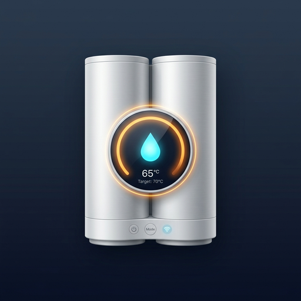

<p align="center">
  
</p>

# Thermor Onix DHW Plus for Home Assistant 🇬🇧

[🇪🇸 Cambiar a versión en Español](README_es.md)

[](https://github.com/hacs/default)
[](https://github.com/antocara/thermor-onix-custom/releases)
[](https://opensource.org/licenses/MIT)

Custom integration for **Home Assistant** specifically designed for **Thermor Onix** double-tank smart electric water heaters (and compatible Atlantic / Sauter models communicating via Cozytouch / Overkiz using the `modbuslink` protocol).

Unlike the generic Overkiz integration, this component exposes **100% of the hidden hardware telemetry and software controls**, including dual independent temperature probes, lifetime heating element hours, granular tariff breakdown counters (Tariff 0, 1, 2), internal hardware schedule slots, and direct switches for Smart Grid (solar surplus diversion), Eco mode, Away mode, and Anti-Legionella thermal protection.

---

## ✨ Key Features

### 🚿 Domestic Hot Water Control (`water_heater`)
* **Target Temperature Regulation:** Adjust target water temperature from **50 °C to 70 °C**.
* **Real-time Outlet Reading:** Continuously tracks water temperature in the primary outlet tank (water ready to use).
* **Operation Modes:**
  * **Manual (`electric`):** Maintains your chosen temperature setpoint.
  * **Eco (`eco`):** Intelligent power saving algorithm.
  * **Boost (`performance`):** Rapid dual-tank emergency heating.
  * **Away (`off`):** Anti-frost vacation protection.

### 🕒 Internal Hardware Scheduling (`select` & `time`)
* **Operating Schedule Mode (`select`):**
  * `24h Continuous`: Standard heating on demand throughout the day.
  * `Programmed Slots`: **Heats exclusively during the defined hardware slots**, remaining softly idle the rest of the day without cutting power via an external smart plug.
  * `Off-Peak Hours (HC)`: Automatic restriction to off-peak grid hours.
* **Slot 1 & Slot 2 Times (`time`):**
  * Four native time entities (`Slot 1 Start`, `Slot 1 End`, `Slot 2 Start`, `Slot 2 End`) that directly configure the water heater's internal memory.

### 🌡️ Advanced Telemetry Sensors (`sensor`)
* **Outlet Tank Temperature:** Measures hot water ready for showers.
* **Inlet / Intermediate Tank Temperature:** Measures preheated water in the secondary tank.
* **Instantaneous Electrical Power (W):** Real-time power consumption in Watts.
* **Total Cumulative Energy (kWh):** Direct integration with Home Assistant's **Energy Dashboard** (`total_increasing`).
* **Tariff Breakdown Energy Counters (kWh):**
  * **Tariff 0:** Baseline / off-peak valley consumption.
  * **Tariff 1:** Morning / shower usage consumption.
  * **Tariff 2:** Energy consumed during Boost mode activations.
* **Heating Element Operating Hours (h):** Lifetime working hours of the electric heating element (ideal for maintenance and anode lifespan tracking).
* **Estimated V40 Volume (L):** Usable liters of hot water mixed at 40 °C.
* **Showers Available:** Number of hot showers currently ready to use.
* **Wi-Fi Signal Strength (dBm):** Connectivity diagnostic for the internal uPod gateway.

### ⚡ Switches & Controls (`switch`)
* **Smart Grid / Solar Surplus Switch:** Toggles the Smart Grid input to absorb excess PV solar production.
* **Anti-Legionella Cycle Switch:** Enables or disables periodic high-temperature thermal disinfection (65–70 °C).
* **Quick Boost Switch:** One-click override to activate rapid dual-tank heating.
* **Eco Mode Switch:** Toggles eco energy-saving algorithm.
* **Away Mode Switch:** Toggles anti-frost soft standby.

### 🔢 Number Selectors & Buttons (`number` & `button`)
* **Expected Showers (`number`):** Slider control (1 to 5 showers) to match hot water production to current household demand.
* **Synchronize Internal Clock (`button`):** Sends current local date & time to the water heater's clock with one click.
* **Refresh Telemetry Now (`button`):** Forces an immediate data fetch from the cloud.

---

## 📦 Installation

### Method 1: Via HACS (Recommended)
1. Open **Home Assistant** and navigate to **HACS** > **Integrations**.
2. Click the 3-dot menu in the top right corner and select **Custom repositories**.
3. Add the repository URL: `https://github.com/antocara/thermor-onix-custom`.
4. In Category, select **Integration**.
5. Find **Thermor Onix DHW Plus** and click **Download**.
6. Restart Home Assistant.

### Method 2: Manual Installation
1. Download this repository.
2. Copy the `thermor_onix_custom` directory into your Home Assistant `custom_components` folder:
   ```text
   /config/custom_components/thermor_onix_custom/
   ```
3. Restart Home Assistant.

---

## ⚙️ Configuration

1. In Home Assistant, go to **Settings** > **Devices & services** > **Add integration**.
2. Search for **Thermor Onix DHW Plus**.
3. Enter your **Thermor Cozytouch** mobile app email and password.
4. Set your preferred polling interval (default is 60 seconds to respect Overkiz cloud rate limits).
5. Click Submit! All entities and sensors will be automatically grouped under one device.

---

## ☀️ Automation Example: Solar PV Surplus Diverter

```yaml
alias: "DHW: Divert Solar Surplus to Water Heater"
description: "Boost water heater temperature to 65°C when solar export exceeds 1.5 kW"
trigger:
  - platform: numeric_state
    entity_id: sensor.powerwall_site_now
    below: -1500
    for:
      minutes: 5
condition:
  - condition: numeric_state
    entity_id: sensor.water_heater_outlet_tank_temperature
    below: 60
action:
  - service: water_heater.set_temperature
    target:
      entity_id: water_heater.water_heater
    data:
      temperature: 65
  - service: switch.turn_on
    target:
      entity_id: switch.water_heater_smart_grid_option
mode: single
```

---

## 📄 License

This project is licensed under the [MIT License](LICENSE).
