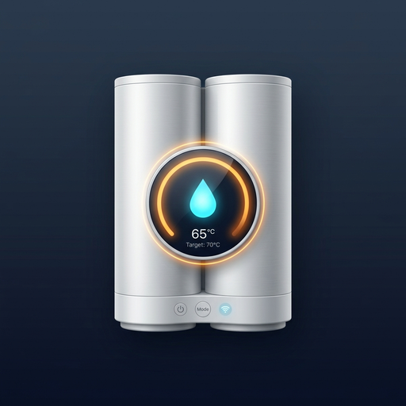

<p align="center">
  
</p>

# Thermor Onix DHW Plus for Home Assistant 🇪🇸

[🇬🇧 Switch to English Version](README.md)

[](https://github.com/hacs/default)
[](https://github.com/antocara/thermor-onix-custom/releases)
[](https://opensource.org/licenses/MIT)

Integración personalizada para **Home Assistant** diseñada para termos eléctricos inteligentes de doble cuba **Thermor Onix** (y gamas compatibles de Atlantic / Sauter que utilicen la pasarela Cozytouch y protocolo `modbuslink`).

A diferencia de la integración genérica de Overkiz, esta integración expone **el 100% de la telemetría oculta del hardware y todos los controles por software**, incluyendo ambas sondas de temperatura independientes, programación horaria interna de slots, horas totales de uso de la resistencia, control de Smart Grid (excedentes fotovoltaicos), modos Eco y Ausencia, y ciclo Anti-Legionela.

---

## ✨ Características Principales

### 🚿 Control de Agua Caliente Sanitaria (`water_heater`)
* **Control de Temperatura Consigna:** Regulación precisa entre **50 °C y 70 °C**.
* **Lectura en tiempo real:** Medición continua de la temperatura en la cuba de salida (agua lista).
* **Modos de funcionamiento:**
  * **Manual (`electric`):** Mantiene la consigna establecida.
  * **Eco (`eco`):** Optimización inteligente de consumo.
  * **Boost (`performance`):** Calentamiento acelerado de emergencia con ambas cubas.
  * **Ausencia (`off`):** Modo antihielo para vacaciones / ausencia prolongada.

### 🕒 Programación Horaria Interna en Hardware (`select` & `time`)
* **Modo de Horario Operativo (`select`):**
  * `24 Horas Continuo`: Calienta bajo demanda durante todo el día (modo estándar).
  * `Solo Franjas Programadas`: **Solo calienta dentro de las franjas horarias configuradas**, permaneciendo en reposo suave el resto del día sin necesidad de cortar la corriente con un enchufe inteligente.
  * `Solo Horas Valle (HC)`: Restricción automática a las horas valle contratadas.
* **Tiempos de Franja 1 y Franja 2 (`time`):**
  * Cuatro entidades de hora nativas (`Franja 1 Inicio`, `Franja 1 Fin`, `Franja 2 Inicio`, `Franja 2 Fin`) para configurar directamente la memoria interna del termo.

### 🌡️ Sensores de Telemetría Avanzada (`sensor`)
* **Temperatura Cuba de Salida:** Sensor de temperatura de agua lista para su uso.
* **Temperatura Cuba Intermedia / Entrada:** Sensor de precalentamiento de la segunda cuba.
* **Potencia Eléctrica Instantánea (W):** Monitorización de consumo en vatios en tiempo real.
* **Consumo Eléctrico Total (kWh):** Compatible con el panel de Energía (*Energy Dashboard*) de Home Assistant (`total_increasing`).
* **Desglose de Tarifas de Consumo (kWh):**
  * **Tarifa 0:** Consumo en horario estándar / nocturno valle.
  * **Tarifa 1:** Consumo en horario matinal de duchas.
  * **Tarifa 2:** Consumo derivado de activaciones en modo Boost.
* **Horas de Resistencia (h):** Contador acumulado del tiempo de vida útil que ha trabajado el elemento calefactor.
* **Volumen V40 Estimado (L):** Litros reales disponibles de agua caliente mezclada a 40 °C.
* **Duchas Disponibles:** Número de duchas restantes estimadas listas para usar.
* **Calidad de Señal Wi-Fi (dBm):** Diagnóstico de conectividad de la pasarela uPod.

### ⚡ Interruptores y Automatizaciones (`switch`)
* **Modo Smart Grid / Excedentes Solares:** Conecta o desconecta la admisión de señal fotovoltaica para absorber excedentes.
* **Ciclo Anti-Legionela:** Activa o desactiva la desinfección térmica periódica.
* **Interruptor Boost Rápido:** Disparo directo para activar calentamiento forzado.
* **Interruptor Modo Eco:** Activa o desactiva el modo de ahorro de energía.
* **Interruptor Modo Ausencia:** Activa o desactiva el reposo antihielo/vacaciones.

### 🔢 Controles Numéricos y Botones (`number` & `button`)
* **Duchas Deseadas (`number`):** Selector deslizante (1 a 5 duchas) para programar la capacidad requerida según los convivientes.
* **Sincronizar Reloj Interno (`button`):** Envía la fecha y hora exacta de Home Assistant al reloj del calentador en un solo clic.
* **Actualizar Telemetría Ahora (`button`):** Fuerza una actualización inmediata de todos los sensores desde la nube.

---

## 📦 Instalación

### Método 1: Mediante HACS (Recomendado)
1. Abre **Home Assistant** y dirígete a **HACS** > **Integraciones**.
2. Pulsa en el menú de los 3 puntos (arriba a la derecha) y selecciona **Repositorios personalizados**.
3. Añade la URL del repositorio: `https://github.com/antocara/thermor-onix-custom`.
4. En Categoría, selecciona **Integración**.
5. Busca **Thermor Onix DHW Plus** y haz clic en **Descargar**.
6. Reinicia Home Assistant.

### Método 2: Instalación Manual
1. Descarga el contenido de este repositorio.
2. Copia la carpeta `thermor_onix_custom` dentro de tu directorio `custom_components/` en Home Assistant:
   ```text
   /config/custom_components/thermor_onix_custom/
   ```
3. Reinicia Home Assistant.

---

## ⚙️ Configuración

1. En Home Assistant, ve a **Ajustes** > **Dispositivos y servicios** > **Añadir integración**.
2. Busca **Thermor Onix DHW Plus**.
3. Introduce tu **correo electrónico** y **contraseña** de la aplicación móvil Thermor Cozytouch.
4. Ajusta el intervalo de actualización si lo deseas (por defecto 60 segundos, para evitar límites de la API de Overkiz).
5. ¡Listo! Se creará un dispositivo con todas las entidades y sensores listos para usar en tus paneles y automatizaciones.

---

## ☀️ Ejemplo de Automatización: Excedentes Solares

```yaml
alias: "Agua Caliente: Aprovechar Excedentes Solares"
description: "Sube la temperatura del termo a 65°C cuando la exportación solar supere los 1.5 kW"
trigger:
  - platform: numeric_state
    entity_id: sensor.powerwall_site_now
    below: -1500
    for:
      minutes: 5
condition:
  - condition: numeric_state
    entity_id: sensor.calentador_de_agua_temperatura_cuba_salida
    below: 60
action:
  - service: water_heater.set_temperature
    target:
      entity_id: water_heater.calentador_de_agua
    data:
      temperature: 65
  - service: switch.turn_on
    target:
      entity_id: switch.calentador_de_agua_modo_smart_grid_excedentes_solares
mode: single
```

---

## 📄 Licencia

Este proyecto está bajo la licencia [MIT](LICENSE).
